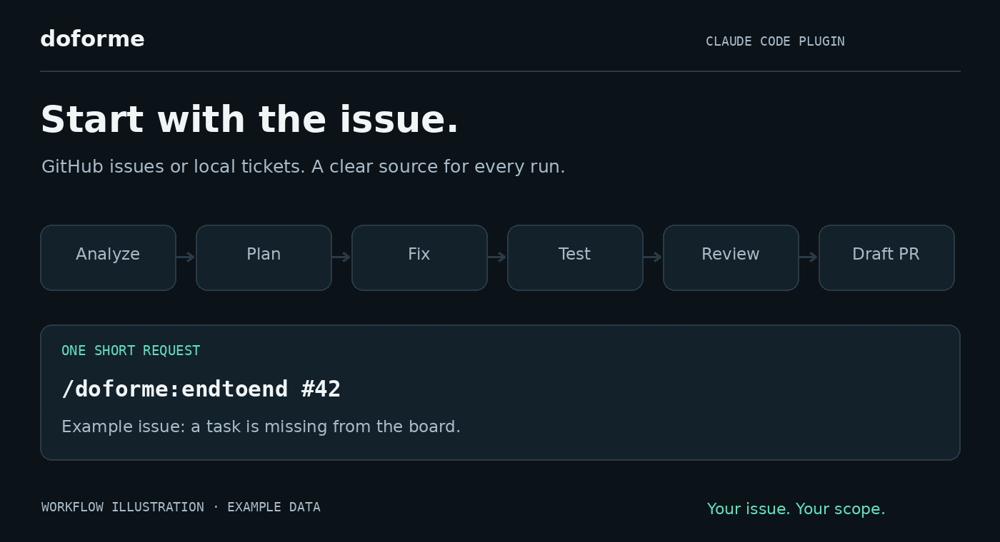
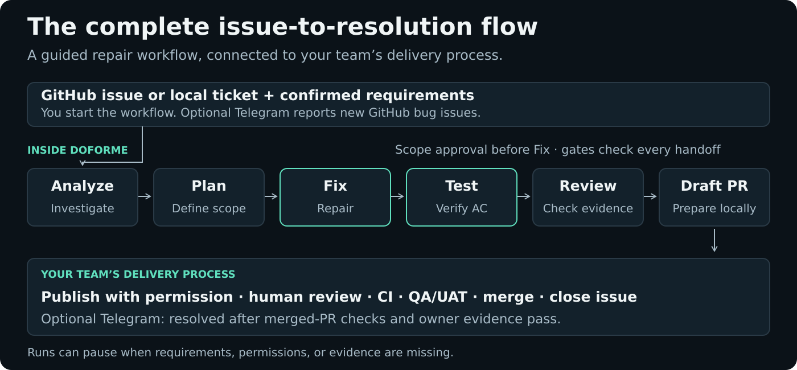

# doforme

**Turn a bug report into a fix your team can review.**

A bug-resolution plugin for **Claude Code and Antigravity CLI**. Connect issues
and business requirements to evidence-backed analysis, reviewable plans, and
scoped repairs.
Bring the issue. Review the plan. Approve the scope. Keep the evidence.

[Get started](docs/GETTING-STARTED.md) · [Explore the workflow](docs/HOW-IT-WORKS.md) · [Antigravity preview](docs/ANTIGRAVITY.md) · [MIT license](LICENSE)

| Runtime | Available workflow |
| --- | --- |
| **Claude Code** | Guided setup, investigation, planning, scoped fixes, testing, review, and a local PR draft. |
| **Antigravity CLI — preview** | Guided setup, repository doctor, saved status, read-only investigation, and planning. |

*The full Claude Code workflow, illustrated with example data. Your approval connects the plan to
code changes; your team's delivery process takes the draft through acceptance.*

## What you get

| Capability | Why it helps |
| --- | --- |
| **Guided setup and short commands** | Start from an issue ID or URL. Doforme handles setup questions, internal inputs, and report handoffs. |
| **Antigravity CLI preview** | Reuse requirement-grounded analysis and planning with a native read-only package. |
| **Evidence before edits** | Investigate issue validity, trace symptoms to source, and separate root-cause hypotheses from facts. |
| **Requirements that shape the repair** | Connect confirmed business rules and AC to the plan and test coverage. Use repository specs or supplied business/Jira/Figma exports. |
| **A scope you can approve** | Review exact files and test commands before the fixer changes code. Clarify ambiguous requirements in the same conversation. |
| **Independent testing and review** | Separate stages inspect behavior, the diff, and evidence before producing a reviewable PR draft. |
| **Progress that stays with the issue** | Saved reports and checkpoints make results, blockers, and next steps visible. New runs preserve previous reports. |
| **GitHub and local ticket support** | GitHub-first selection clearly labels each source. Local tickets support labs and offline work. |
| **Optional Telegram updates** | Notify your team about new bugs and owner-attested resolution through a separate project integration. |

## See how end-to-end connects

The full Claude Code workflow prepares a local PR draft. Your team controls publication, review, and
business acceptance. Telegram resolution updates require the relevant merged PR,
required checks, and owner evidence.

## Work at your pace

In Claude Code, choose how far to take each issue:

**Review each stage.** Investigate first, inspect the plan, then continue through
fix, test, review, and draft preparation using the same issue identity.

**Run end-to-end.** Let the coordinator connect the stages, pause for scope
approval after planning, and surface missing requirements or evidence when needed.

[Install and try your first issue](docs/GETTING-STARTED.md) ·
[Watch the illustrated workflow](docs/WORKFLOW-PREVIEW.md) · [Change history](CHANGELOG.md)
