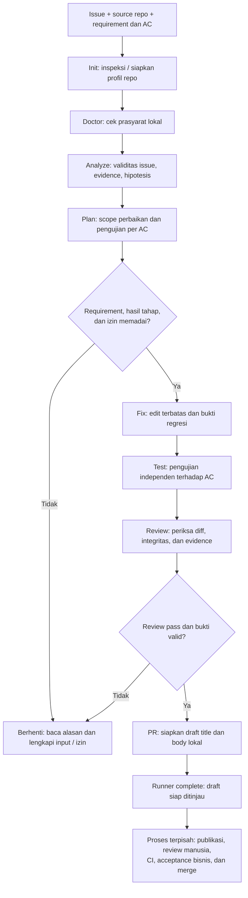
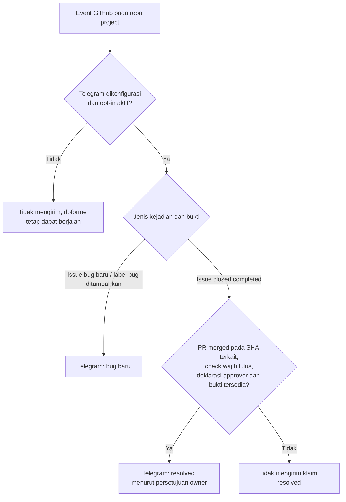

# Bagaimana doforme bekerja

doforme adalah plugin Claude Code yang mengubah laporan bug menjadi investigasi,
rencana, perubahan terbatas, bukti pengujian, review, dan draft PR. Setiap tahap
memiliki agent, instruksi, dan laporan sendiri. Command singkat memakai coordinator
di sesi utama untuk setup, pertanyaan, dan pengambilan laporan per issue. Worker
tetap terpisah; coordinator bukan investigator atau fixer. [Panduan mudah](GUIDED-USAGE.md).
Runner end-to-end mengoordinasikan
tahap tersebut dengan pemeriksaan hasil dan checkpoint; mode manual memberikan
kendali handoff kepada pengguna.

## Dari mana sumber kebenarannya?

Issue menjelaskan masalah yang dilaporkan. Perilaku yang seharusnya ditentukan
oleh requirement dan acceptance criteria (AC) yang dikonfirmasi berlaku untuk
issue tersebut. Sumbernya dapat berupa dokumen bisnis, tiket Jira, desain Figma,
atau spesifikasi di repo.

Siapkan isi sumber beserta locator/versi dan konfirmasi scope dari pemilik
requirement. URL saja tidak menggantikan konten sumber. Bila sumber bertentangan
atau AC belum jelas, doforme perlu klarifikasi sebelum perbaikan dilanjutkan.
Tidak ada aturan bahwa issue, kode existing, atau hasil model selalu menjadi
otoritas tertinggi. Bukti visual Figma juga memerlukan pemeriksaan visual yang
sesuai; teks atau test unit saja tidak membuktikan kecocokan tampilan.

Panduan: [setup requirement](ONBOARDING.md), [contoh input](requirement-input.example.md),
dan [snapshot sumber](SOURCES.md). Plugin tidak otomatis mengambil seluruh
dokumen bisnis, Jira, atau Figma hanya karena URL dicantumkan.

## Diagram alur end-to-end

Init dan doctor adalah persiapan yang dijalankan pengguna; keduanya bukan tahap
model dalam enam tahap runner. Doctor memeriksa kesiapan teknis lokal, bukan
mengesahkan isi requirement. Setiap tahap runner juga dapat berhenti bila
input, evidence, izin, atau hasil tahap sebelumnya tidak memenuhi kontraknya.
Diagram tidak berarti setiap issue pasti berlanjut sampai PR.

## Tugas setiap tahap

| Tahap | Yang dilakukan | Hasil utama |
| --- | --- | --- |
| Analyze | Membaca issue, source, dan requirement tanpa mengedit atau menjalankan test | Validitas issue, evidence dengan lokasi sumber, hipotesis root cause, confidence, dan next steps |
| Plan | Menyusun perbaikan berdasarkan hasil investigasi dan AC | Scope file, rencana perubahan, pengujian per AC, risiko dan blocker |
| Fix | Mengubah file yang diizinkan serta mengamati kegagalan regresi dan hasil sesudah perbaikan | Diff dan bukti sebelum/sesudah yang terkait bug |
| Test | Memeriksa perbaikan secara independen menggunakan command yang diizinkan | Hasil aktual pengujian, cakupan AC, dan kekurangan bukti |
| Review | Membaca diff, laporan dan evidence serta memeriksa keterikatannya pada revisi | Verdict review dan temuan; tahap ini tidak menjalankan test |
| PR | Menyusun judul dan deskripsi berdasarkan hasil yang telah direview | Draft lokal; tidak otomatis push, membuat PR remote, merge, atau menutup issue |

Confidence pada laporan adalah tingkat keyakinan investigasi berdasarkan evidence,
bukan persetujuan bisnis. Hipotesis tetap harus dibedakan dari root cause yang
didukung bukti. Error environment atau dependency bukan bukti bahwa bug berhasil
direproduksi atau diperbaiki.

## Manual atau end-to-end

**Terpandu per issue:** panggil analyze, plan, fix, test, review dan pr dengan ID
yang sama, misalnya `/doforme:analyze BUG-301`. Host menyimpan laporan dan berhenti
setelah tahap yang diminta. Scope hasil plan ditinjau sebelum fix.

**Manual advanced:** panggil `/doforme:analyze`, `/doforme:plan`, `/doforme:fix`,
`/doforme:test`, `/doforme:review`, lalu `/doforme:pr`. Setiap tahap memakai
konteks terpisah. Teruskan laporan lengkap sebagai input tahap berikutnya;
command manual tidak otomatis menyimpan file laporan dengan nama tertentu.

**End-to-end terpandu:** `/doforme:endtoend BUG-301` berjalan sampai plan, meminta
persetujuan scope, lalu melanjutkan. Penyimpanan/input dikelola helper.

**End-to-end advanced:** panggil `/doforme:endtoend` dengan input issue, profil repo, output
baru di luar checkout, dan izin eksplisit. Runner memanggil model terpisah per
tahap, memvalidasi handoff, dan menyimpan laporan, evidence serta checkpoint.
Biaya dan batas eksekusi mengikuti akun model serta konfigurasi run.

Profil repo menyediakan default requirement, test command, dan batas run.
Profil maupun teks issue tidak memberi izin edit atau eksekusi dengan sendirinya.
Fix/test memerlukan persetujuan langsung atas file dan command yang tepat.
Langkah lengkap dan contoh command ada di [panduan penggunaan](USAGE.md).

## Apa yang terjadi bila run berhenti?

Gunakan `/doforme:status` untuk membaca hasil dan alasan berhenti tanpa memanggil
model. Resume memerlukan input, output, izin, dan kondisi repo yang cocok dengan
checkpoint. Tahap blocked/failed/interrupted memerlukan retry eksplisit dan
tetap harus memenuhi gerbang yang sama.

Perubahan HEAD, source, konfigurasi, atau policy dapat membuat checkpoint stale.
Periksa perubahan parsial sebelum melanjutkan; resume bukan cara melewati
requirement atau verdict review. Batas eksekusi dan isolasi dijelaskan di
[panduan operasional](OPERATIONS.md).

## Kapan bug dianggap resolved?

Runner complete berarti draft memenuhi kontrak workflow dan siap ditinjau.
Test hijau menunjukkan hasil teknis pada scope yang diuji. Keduanya tidak
otomatis membuktikan seluruh requirement bisnis sudah diterima.

Pemilik requirement memberi keputusan penerimaan berdasarkan AC dan bukti
QA/UAT pada revisi yang relevan. [Validator acceptance](ACCEPTANCE.md) memeriksa
bukti keputusan manusia yang diberikan; ia tidak memberi persetujuan bisnis
atas nama owner. [Publikasi draft PR](PUBLISHING.md) memakai helper terpisah
dengan preview dan izin eksplisit. Commit/push, review, merge, dan penutupan issue
tetap mengikuti proses serta otorisasi repo project.

## Di mana posisi Telegram?

Telegram adalah integrasi opsional yang dipasang di **repo project**. Workflow
notifikasi terpisah dari runner doforme dan dapat dipakai untuk fix manual juga.

Notifikasi bug baru tidak otomatis menjalankan Claude atau memperbaiki issue.
Notifikasi resolved mengikuti bukti dan deklarasi approver yang dikonfigurasi;
test hijau atau penutupan issue saja tidak cukup. Detail event, konfigurasi,
serta batas verifikasi tersedia di [panduan Telegram](TELEGRAM.md).
