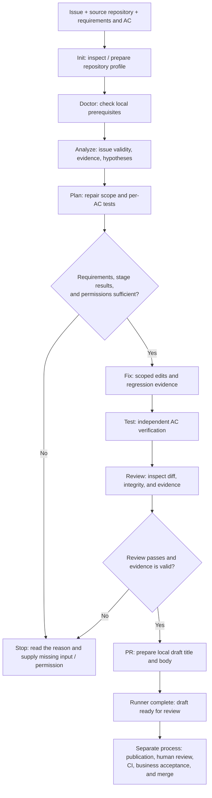
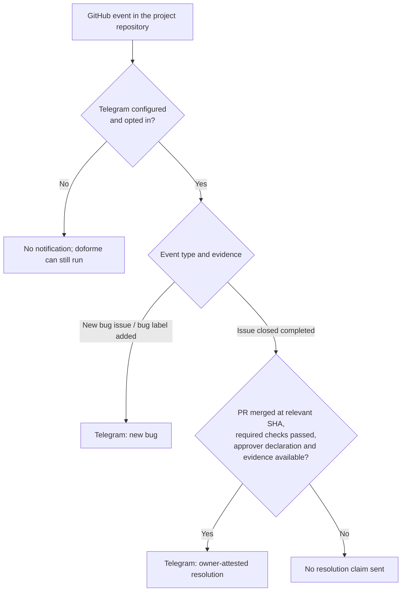

# How doforme works

doforme is a Claude Code plugin that turns bug reports into investigations, plans,
scoped changes, test evidence, review, and PR drafts. Each stage has its own agent,
instructions, and report. Short commands use a main-session coordinator for setup,
questions, and per-issue report lookup. Workers remain separate; the coordinator
is not the investigator or fixer. See [guided usage](GUIDED-USAGE.md).
The end-to-end runner coordinates stages through result checks and checkpoints;
manual mode leaves handoff control to the user.

## What is the source of truth?

The issue describes a reported problem. Expected behavior comes from requirements
and acceptance criteria (AC) confirmed to apply to that issue. Sources may include
business documents, Jira tickets, Figma designs, or repository specifications.

Provide source content, locators/versions, and requirement-owner scope confirmation.
A URL alone does not replace content. Conflicting sources or unclear AC require
clarification before repairs proceed. No rule makes the issue, existing code, or
model output the ultimate authority in every case. Figma visual evidence requires
appropriate visual inspection; text or unit tests alone do not establish visual conformity.

See [requirement setup](ONBOARDING.md), [example inputs](requirement-input.example.md),
and [source snapshots](SOURCES.md). Supplying a URL does not automatically fetch
all business, Jira, or Figma documents.

## End-to-end workflow diagram

Init and doctor are user-run preparation, not model stages in the six-stage runner.
Doctor checks local technical readiness, not requirement validity. Each runner
stage can also stop if inputs, evidence, permissions, or predecessor results fail
its contract. The diagram does not imply every issue reaches a PR.

## What each stage does

| Stage | Work | Main output |
| --- | --- | --- |
| Analyze | Read issue, source, and requirements without edits or test execution | Issue validity, located evidence, root-cause hypotheses, confidence, next steps |
| Plan | Plan repairs from investigation and AC | File scope, changes, per-AC tests, risks, blockers |
| Fix | Edit authorized files and observe regression failure/post-fix results | Diff and bug-related before/after evidence |
| Test | Independently check repairs using authorized commands | Actual test results, AC coverage, evidence gaps |
| Review | Read diff/reports/evidence and inspect revision binding | Review verdict and findings; no test execution |
| PR | Draft title/body from reviewed results | Local draft; no automatic push, remote PR, merge, or issue closure |

Confidence is evidence-based investigation confidence, not business approval.
Distinguish hypotheses from root causes supported by evidence. Environment or
dependency errors do not prove successful bug reproduction or repair.

## Manual or end-to-end

**Guided per issue:** invoke analyze, plan, fix, test, review, and pr with the same
ID, such as `/doforme:analyze BUG-301`. The host saves reports and stops after the
requested stage. Planned scope is reviewed before fixing.

**Advanced manual:** invoke `/doforme:analyze`, `/doforme:plan`, `/doforme:fix`,
`/doforme:test`, `/doforme:review`, and `/doforme:pr`. Each stage uses a separate
context. Supply complete reports as the next stage's inputs; manual commands do
not automatically save files with prescribed report names.

**Guided end-to-end:** `/doforme:endtoend BUG-301` runs through planning, requests
scope approval, then continues. The helper manages storage and inputs.

**Advanced end-to-end:** invoke `/doforme:endtoend` with issue input, repository
profile, new output outside the checkout, and explicit grants. The runner calls
models separately per stage, validates handoffs, and saves reports, evidence, and
checkpoints. Costs/execution limits follow your model account and run configuration.

Repository profiles supply default requirements, test commands, and run caps.
Profiles and issue text do not grant edit/execution permission themselves. Fix/test
need direct approval for exact files/commands. Full steps and examples are in
[usage](USAGE.md).

## What happens when a run stops?

Use `/doforme:status` to read results and stop reasons without calling a model.
Resume requires inputs, output, grants, and repository conditions matching the
checkpoint. Blocked/failed/interrupted stages require explicit retry and must
still meet the same gates.

Changed HEAD, source, configuration, or policy can make checkpoints stale. Review
partial changes before continuing; resume does not bypass requirements or review
verdicts. Execution/isolation limits are in [operations](OPERATIONS.md).

## When is a bug resolved?

Runner complete means the draft meets workflow contracts and is ready for review.
Passing tests establish technical results in tested scope. Neither automatically
establishes acceptance of every business requirement.

The requirement owner decides acceptance against AC and QA/UAT evidence on the
relevant revision. [Acceptance validation](ACCEPTANCE.md) checks supplied human
decisions; it does not approve business outcomes for the owner. [Draft PR publication](PUBLISHING.md)
uses a separate helper with preview and explicit permission. Commit/push, review,
merge, and issue closure follow project procedures and authorization.

## Where does Telegram fit?

Telegram is optional and installed in the **project repository**. Its notification
workflow is separate from the doforme runner and also supports manual fixes.

A new-bug notification does not automatically run Claude or fix the issue.
Resolution notifications follow configured approver evidence/declarations; passing
tests or closure alone are insufficient. Events, configuration, and verification
limits are documented in [Telegram](TELEGRAM.md).
