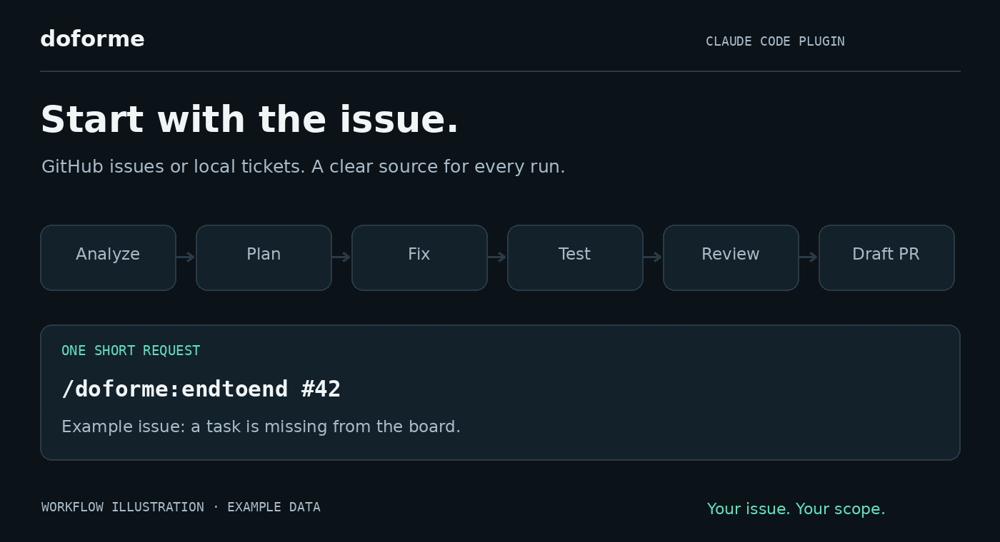

# The doforme workflow at a glance

This short animation introduces the guided workflow using example issue data.
It is a motion-graphic illustration, not a recording of a completed live fix or
an acceptance claim for a real issue. Issue #42 is an illustrative identifier.

[View the still preview](media/workflow-preview-poster.png) or
[open the complete workflow diagram](media/workflow-overview.svg).

## The story

1. **Start with an issue.** Choose a GitHub issue or local ticket and keep its source explicit.
2. **Understand the problem.** Trace reported behavior to source and confirmed requirements.
3. **Approve the plan.** Review proposed file edits and exact test commands.
4. **Make a scoped repair.** Record a bug-related regression failure and post-fix results.
5. **Verify independently.** Check behavior against AC, then review the diff and evidence.
6. **Prepare a PR draft.** Summarize the change, test results, risks, and remaining gaps.
7. **Complete your delivery process.** Publish with permission, perform human review,
   CI and QA/UAT, merge, and close the issue under project policy.

Guided setup and requirement clarification may add pauses before or between these
steps. A new GitHub issue or Telegram notification does not automatically start
Claude. Passing tests or a draft alone do not establish business acceptance.

## Optional team notifications

Install Telegram configuration in the project repository. New-bug notifications
are separate from doforme execution. Resolution notifications require the merged
PR, matching commit/checks, approver declaration, evidence, and completed issue
closure. See [Telegram](TELEGRAM.md) for the exact gates.

## A live demo to record next

For a real product walkthrough, record one approved issue end-to-end:

- Show the GitHub issue and its AC.
- Start the short command and answer the requirement/scope questions.
- Show the actual regression result before and after the repair.
- Open independent test/review evidence and the resulting local PR draft.
- Show human acceptance and Telegram delivery only if they were actually performed.

Keep tokens, private issue data, personal paths, and credentials out of the recording.
A successful synthetic test or illustrated animation should not substitute for
live pilot evidence. [Get started](GETTING-STARTED.md) or read [how doforme works](HOW-IT-WORKS.md).

## Maintaining these visuals

The assets use the project's MIT license. The animation is an eight-frame looping
GIF; the diagram is editable SVG. To regenerate them, a contributor can run
`python3 docs/media/build_preview.py` from the plugin checkout with Pillow and
DejaVu Sans/Mono installed. These are optional media-authoring dependencies, not
plugin runtime requirements. Review every frame and diagram after changes.
